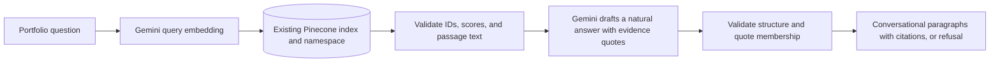

# Joi Emmanuel Holgado — Portfolio

React, TypeScript, and Vite portfolio with a Node/TypeScript portfolio assistant using Gemini and existing Pinecone data. The assistant reads the populated `portfolio` index; it does not import the downloadable resume or write vectors.

## Run locally

Use Node.js 22.16+.

```sh
npm install
```

Copy `.env.example` to `.env`. In PowerShell:

```powershell
Copy-Item .env.example .env
```

Fill in the server-only keys and use the existing index settings:

```dotenv
GEMINI_API_KEY=your-google-ai-studio-key
PINECONE_API_KEY=your-pinecone-project-key
PINECONE_INDEX=portfolio
PINECONE_NAMESPACE=__default__
GEMINI_MODEL=gemini-3.5-flash-lite
GEMINI_EMBEDDING_MODEL=gemini-embedding-001
EMBEDDING_DIMENSIONS=3072
RAG_MIN_SCORE=0.5
```

`PINECONE_INDEX` is the index **name**, not its host URL. The existing `portfolio` index uses **3072 dimensions and cosine similarity**. `PINECONE_NAMESPACE` must name the exact namespace containing the records. This project targets `__default__`; an empty value also targets Pinecone's default namespace. No document hash or version suffix is appended. If your records are in another namespace, use that exact name.

Each searchable record needs its passage text in the string field `metadata.text`. Query embeddings must use the **same embedding model and dimensions used to create the stored vectors**. The current data was created with `gemini-embedding-001`, so this is the supported model. Equal vector dimensions alone do not make another model compatible.

Get a Gemini API key from [Google AI Studio](https://aistudio.google.com/apikey) and a Pinecone project key from the [Pinecone console](https://app.pinecone.io/). The keys must have access to the existing index, embedding model, and configured chat model, with available quota. Never use a `VITE_` prefix for credentials: Vite exposes those values to browsers. `.env` is ignored by Git.

Start both services:

```sh
npm run dev
```

Open **http://127.0.0.1:4173** to use the portfolio assistant. Vite forwards `/api` requests to Node at `127.0.0.1:3001`. Visiting the API's root URL redirects to the Vite website during development. If you change `PORT`, update the Vite proxy target too.

No ingestion step is needed for chat or startup. Without credentials, the portfolio still works and the chat shows an unavailable message. It does not simulate answers. On Windows, if PowerShell blocks `npm.ps1`, use `npm.cmd` in place of `npm`.

## How answers use existing data



The server embeds each question using `gemini-embedding-001` with `RETRIEVAL_QUERY` and normalizes the vector before querying the configured namespace. It searches up to 30 records, removes repeated IDs and passage text, and supplies up to six distinct passages to the answer model. It accepts only records with valid IDs, sufficient similarity scores, and nonempty `metadata.text` of at most 12,000 characters. Chat never creates an index, upserts records, or changes namespaces.

Only the last two **user questions** may supply context for follow-ups. Assistant messages are never evidence. No chat history is persisted by this application. Questions and retrieved passage text are sent to Gemini, and query vectors are sent to Pinecone.

## Grounding and hallucination limits

The assistant gives natural, conversational answers with supporting evidence:

- Gemini returns a support decision, answer paragraphs, and supporting quotes through the structured schema `{ supported: boolean, paragraphs: [{ text, evidence: [{ evidenceId, quote }] }] }`. A response can contain up to four paragraphs of at most 800 characters each. Each paragraph needs one to six evidence entries, with each quote limited to 360 characters, drawn from at most three distinct sources overall.
- The server validates the response structure and verifies each evidence quote is an exact substring of its cited passage after whitespace normalization, with word boundaries. It rejects malformed responses, unexpected fields, invented source IDs, invalid quotes, and model-written numeric citations. Retrieved passages must also pass the similarity threshold.
- The model may paraphrase the evidence. The server adds numbered citations to each paragraph. Full source passages remain available in the collapsed sources section. Sources have no fabricated PDF pages or URLs.
- If evidence is missing, ambiguous, or invalid, the assistant says it cannot answer. Provider failures show a retryable error, without a generated fallback.
- Instructions treat questions, history, and source text as untrusted data, decline unrelated requests, and prohibit unsupported calculations or assumptions about salary, availability, qualifications, and experience.

The default tone is friendly and professional, with two short paragraphs that refer to Joi in the third person. Answers should address the question directly and avoid unrelated contact details or surrounding text. A document metadata reference to Canva does not establish that it is a listed skill. Instructions prohibit inventing tools, asserting current habits from past experience, or adding a tool's purpose merely because the model knows what that tool can do.

Quote membership checks confirm that cited wording appears in the retrieved source. They do **not** deterministically prove that every claim in the answer is supported, complete, or faithful to its context. Semantic faithfulness depends on the model following instructions to preserve qualifications and negation, avoid unsupported inferences, and refuse questions the evidence cannot answer. Valid quotes do not establish that stored data is accurate or current. The configured Pinecone data is the source of evidence; it is not compared with a local PDF. Review the full source passages for context and dates. A source that says “Present” does not establish a current employment status.

`RAG_MIN_SCORE` defaults to `0.5`; it is a retrieval heuristic, **not** a confidence probability. Evaluate with real questions and your own Gemini/Pinecone account before changing it. Tests cover deterministic guardrails and mocked API behavior; they do not measure live model relevance or prompt-injection resistance.

Try questions such as “What frontend skills are listed?” or “What degree is listed?” Check that requests for unsupported facts or invented achievements receive refusals. These require live credentials to evaluate against the model and existing data.

## Updating portfolio information

Manage source records through the process that populated your Pinecone index. Keep the text in `metadata.text`, use the same embedding model and dimensions, and target the configured namespace. Chat retrieves the current records directly; no local PDF hash or document version is required.

The downloadable resume at `public/assets/joi-emmanuel-holgado-resume.pdf` is a separate portfolio asset. Replacing it does not update Pinecone records or alter the assistant's evidence. Rebuild the frontend when replacing a public asset for production, because Vite copies it into `dist/`.

## Build, verify, and deploy

```sh
npm test
npm run build
npm start
```

Stop `npm run dev` before running `npm start`, since both use the API port. With `npm start`, open **http://127.0.0.1:3001** (or your configured `HOST`/`PORT`): Node serves the built website and API together. Rebuild after source changes before restarting production. Restart the Node service after changing environment settings.

The build checks frontend and backend types, writes frontend assets to `dist/`, and compiles Node TypeScript to `dist-server/`. Deploy `dist/`, `dist-server/`, package files, and production dependencies. Supply environment settings through your host's secret manager or `.env`, and set `HOST=0.0.0.0` on hosts that require it. Chat startup does not read a local PDF or run an ingestion job; the downloadable resume is included in the built frontend assets.

For a single instance behind a trusted reverse proxy, set `TRUST_PROXY_HOPS` to the exact known hop count. The API limits each client IP to 20 requests per 10 minutes, bounds JSON input, allows four concurrent model calls, and applies a 35-second request timeout. Provider calls have 15-second timeouts. The rate-limit store is in memory; multiple instances need a shared rate-limit store or gateway limits. All browser API calls are same-origin; a static-only host must proxy `/api` to the Node service. `npm run preview` previews static assets only and does not start/proxy the backend.

`GET /api/health` reports process health and whether API credentials are configured. It does not check provider connectivity or confirm that a namespace is populated. `POST /api/chat` accepts:

```json
{
  "message": "What frontend skills are listed?",
  "history": []
}
```

Messages are limited to 1,500 characters. Optional history accepts up to six user/assistant entries of 4,000 characters each, within a 16 KB total JSON body limit. Responses contain `answer`, `status` (`answered` or `insufficient_evidence`), and `sources` containing only `id` and `text`:

```json
{
  "answer": "Joi has worked with React and TypeScript. [1]",
  "status": "answered",
  "sources": [{ "id": "record-id", "text": "Joi has worked with React and TypeScript." }]
}
```

Source IDs refer to retrieved records. They do not identify pages in the downloadable resume. API/provider failures return a JSON error with an appropriate HTTP status.

## Source layout

- `server/rag.ts`: query embeddings, existing-index retrieval, evidence-supported answer generation.
- `server/grounding.ts`: input validation, retrieved passage checks, evidence quote validation, paragraph citations.
- `server/providers.ts`: Gemini/Pinecone clients, embedding normalization, provider timeouts.
- `server/config.ts`: server-only settings and configuration validation.
- `server/app.ts`: Express API, limits, errors, production static serving.
- `src/components/ResumeChat/`: accessible chat, suggested questions, loading/retry/reset, expandable sources.
- `server/resume.ts` and `server/ingest.ts`: standalone legacy PDF import utilities; unused by chat and startup.

Keep professional titles, employers, dates, qualifications, and skills consistent with supporting source material. Portraits and the downloadable resume live under `public/assets/`.

API references: [Gemini embeddings](https://ai.google.dev/gemini-api/docs/embeddings), [Gemini structured outputs](https://ai.google.dev/gemini-api/docs/structured-output), and [Pinecone TypeScript SDK](https://github.com/pinecone-io/pinecone-ts-client).
